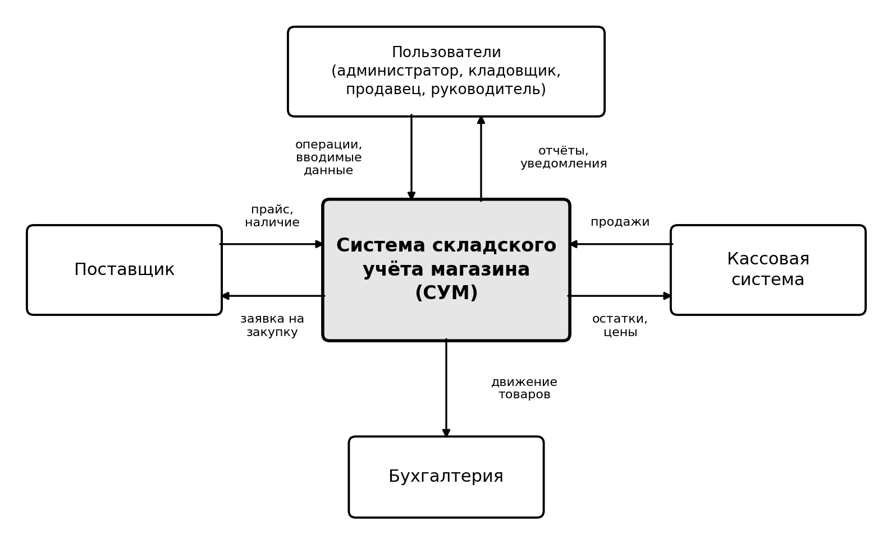
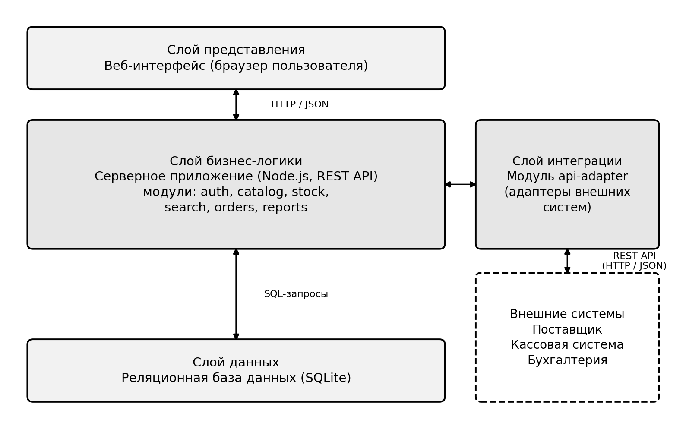
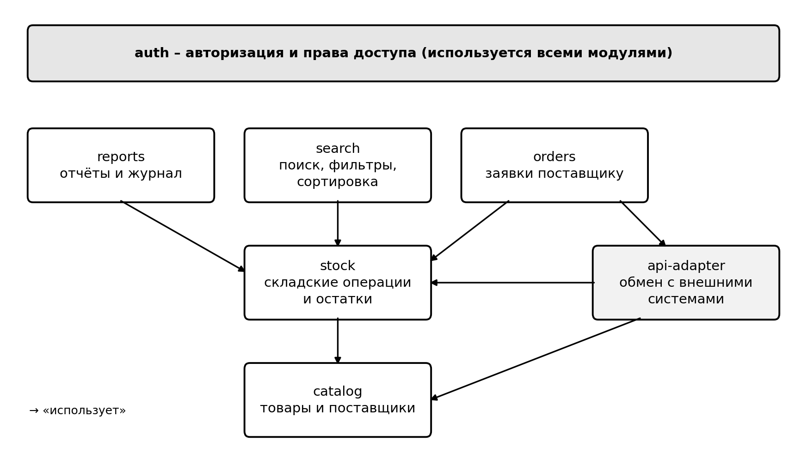

# Паспорт системы: Система складского учёта магазина (СУМ)

Версия 1.0, 16.10.2026. Репозиторий: https://github.com/boakhtar/lab_stp

## 1. Назначение
Автоматизация учёта товаров на складе розничного магазина: каталог товаров, поступления и продажи, контроль остатков, отчёты, обмен данными с внешними системами (поставщик, касса, бухгалтерия).

**Границы (не входит):** приём оплаты, бухгалтерский и налоговый учёт, доставка.

**Платформа:** Node.js (JavaScript), REST API, JSON, SQLite.

## 2. Роли
| Роль | Что делает в системе |
|---|---|
| Администратор | Создаёт пользователей, назначает права доступа, просматривает журнал операций |
| Кладовщик | Принимает товар, оформляет списания, проводит инвентаризацию, ведёт каталог и поставщиков |
| Продавец | Оформляет продажи, просматривает наличие товара |
| Руководитель | Просматривает отчёты, задаёт минимальные остатки товаров |

## 3. Функциональные требования
| Код | Функция | Кто использует | Ядро* |
|---|---|---|---|
| ФТ-01 | Вход по логину и паролю, разграничение прав по ролям | Все | да |
| ФТ-02 | Ведение каталога товаров (создание, изменение, архивация; артикул, название, категория, цена, единица измерения) | Кладовщик, администратор | да |
| ФТ-03 | Ведение справочника поставщиков | Кладовщик |  |
| ФТ-04 | Оформление поступления товара (приходная накладная), увеличение остатка | Кладовщик | да |
| ФТ-05 | Оформление продажи (расходная накладная) с проверкой достаточности остатка | Продавец | да |
| ФТ-06 | Просмотр текущих остатков по товару и по складу | Все | да |
| ФТ-07 | Списание товара (брак, потеря, истёк срок) | Кладовщик |  |
| ФТ-08 | Инвентаризация: сверка фактического остатка с учётным | Кладовщик |  |
| ФТ-09 | Поиск, фильтрация и сортировка товаров (по названию, категории, цене, остатку) | Все | да |
| ФТ-10 | Автоматическое формирование заявки поставщику, если остаток ниже минимального | Система | да |
| ФТ-11 | Формирование отчётов: остатки, движение товара, продажи за период | Руководитель |  |
| ФТ-12 | Обмен данными с внешними системами через API | Система | да |
| ФТ-13 | Журнал операций: кто, когда и что изменил | Администратор |  |

* «Ядро» – функции, реализуемые в рамках лабораторных работ № 4–5; остальные остаются в паспорте как план развития системы.

## 4. Входные данные
| Данные | Источник | Формат | Способ передачи |
|---|---|---|---|
| Прайс-лист и наличие у поставщика | Система поставщика | JSON | API |
| Данные о продажах | Кассовая система | JSON | API |
| Приходная накладная | Кладовщик | Ввод в форму | Интерфейс |
| Акт списания, результаты инвентаризации | Кладовщик | Ввод в форму | Интерфейс |
| Логин и пароль | Пользователь | Ввод в форму | Интерфейс |

## 5. Выходные данные
| Данные | Получатель | Формат | Способ передачи |
|---|---|---|---|
| Текущие остатки товаров | Кассовая система | JSON | API |
| Заявка на закупку | Поставщик | JSON | API |
| Данные о движении товаров | Бухгалтерия | CSV / JSON | Выгрузка / API |
| Отчёты по остаткам и продажам | Руководитель | Экран, XLSX | Интерфейс |
| Уведомление о низком остатке | Кладовщик, руководитель | Письмо | Электронная почта |

## 6. Внешние системы
| Система | Описание | Передаёт в СУМ | Получает от СУМ |
|---|---|---|---|
| Поставщик | Система компании, у которой магазин закупает товар | Прайс-лист, наличие | Заявки на закупку |
| Кассовая система | Программа на кассе, пробивающая чеки | Данные о продажах | Остатки и цены |
| Бухгалтерия | Бухгалтерская программа | Ничего | Данные о движении товаров |

## 7. Интерфейсы обмена
| Код | Направление | Операция | Метод и адрес | Данные | Инициатор |
|---|---|---|---|---|---|
| ИФ-01 | Поставщик → СУМ | Получить прайс и наличие | `GET /supplier/prices` | Список товаров, JSON | СУМ, по расписанию |
| ИФ-02 | СУМ → Поставщик | Отправить заявку на закупку | `POST /supplier/orders` | Заявка, JSON | СУМ, при низком остатке |
| ИФ-03 | Касса → СУМ | Передать данные о продаже | `POST /api/sales` | Продажа, JSON | Касса |
| ИФ-04 | СУМ → Касса | Отдать остаток товара | `GET /api/stock/{sku}` | Остаток, JSON | Касса, по запросу |
| ИФ-05 | СУМ → Бухгалтерия | Выгрузить движение товаров | `GET /api/movements` | Операции, JSON или CSV | Бухгалтерия |

## 8. Нефункциональные требования
| Код | Категория | Требование | Как проверить |
|---|---|---|---|
| НФТ-01 | Платформа | Серверная часть реализуется на JavaScript (Node.js), обмен данными в формате JSON | Просмотр кода и ответов API |
| НФТ-02 | Хранение | Данные хранятся в реляционной БД (на этапе лабораторных SQLite, возможен переход на PostgreSQL) | Проверка схемы БД |
| НФТ-03 | Интерфейс | Пользовательский интерфейс работает в браузере, язык русский | Открытие в браузере |
| НФТ-04 | Производительность | 95% запросов выполняются не дольше 2 с при каталоге до 10 000 товаров | Замер времени запросов |
| НФТ-05 | Нагрузка | Одновременная работа до 10 пользователей | Нагрузочная проверка |
| НФТ-06 | Безопасность | Пароли хранятся только в виде хеша | Просмотр таблицы пользователей |
| НФТ-07 | Безопасность | Доступ к функциям ограничен ролью пользователя | Вход под разными ролями |
| НФТ-08 | Безопасность | Обмен с внешними системами идёт по защищённому каналу HTTPS | Проверка адресов интерфейсов |
| НФТ-09 | Надёжность | Резервная копия БД создаётся раз в сутки | Проверка расписания копирования |
| НФТ-10 | Надёжность | Операция выполняется целиком или не выполняется вообще (данные не искажаются) | Прерывание операции, проверка остатков |
| НФТ-11 | Сопровождаемость | Исходный код хранится в Git по схеме веток main / develop / feature/* | Репозиторий lab_stp |
| НФТ-12 | Качество | Ядро системы (ФТ-01, 02, 04, 05, 06, 09, 10, 12) покрыто тестовыми сценариями | Результаты ЛР6 |

## 9. Архитектура
Клиент-серверная многослойная: представление (веб-интерфейс), бизнес-логика (Node.js, REST API), данные (SQLite), интеграция (api-adapter).

## 10. Модули
| Код | Модуль | Назначение | Реализует | Ветка Git |
|---|---|---|---|---|
| М-01 | `auth` | Авторизация, роли и права доступа | ФТ-01 | `feature/module-auth` |
| М-02 | `catalog` | Каталог товаров и справочник поставщиков | ФТ-02, ФТ-03 | `feature/module-catalog` |
| М-03 | `stock` | Складские операции (поступление, продажа, списание, инвентаризация) и остатки | ФТ-04…ФТ-08 | `feature/module-stock` |
| М-04 | `search` | Поиск, фильтрация и сортировка товаров | ФТ-09 | `feature/module-search` |
| М-05 | `orders` | Контроль минимальных остатков и заявки поставщику | ФТ-10 | `feature/module-orders` |
| М-06 | `reports` | Отчёты и журнал операций | ФТ-11, ФТ-13 | `feature/module-reports` |
| М-07 | `api-adapter` | Адаптеры обмена с поставщиком, кассой и бухгалтерией | ФТ-12 (ИФ-01…05) | `feature/integration-api` |

### Зависимости
| Модуль | Использует |
|---|---|
| `stock` | `catalog` |
| `search` | `stock` |
| `reports` | `stock` |
| `orders` | `stock`, `api-adapter` |
| `api-adapter` | `stock`, `catalog` |
| Все модули | `auth` (проверка прав доступа) |

### Операции модулей
| Модуль | Основные операции (интерфейс модуля) |
|---|---|
| `auth` | `login`, `logout`, `checkAccess` |
| `catalog` | `createItem`, `updateItem`, `archiveItem`, `getItem`, `listSuppliers` |
| `stock` | `receive`, `sell`, `writeOff`, `runInventory`, `getBalance` |
| `search` | `find` (запрос, фильтры, порядок сортировки) |
| `orders` | `checkMinStock`, `createOrder` |
| `reports` | `stockReport`, `movementReport`, `salesReport`, `auditLog` |
| `api-adapter` | `pullSupplierPrices`, `sendSupplierOrder`, `receiveSale`, `getStock`, `exportMovements` |

## 11. Предварительные сущности данных
- Товар (артикул, название, категория, цена, единица измерения, минимальный остаток)
- Категория товара
- Поставщик
- Пользователь (логин, хеш пароля, роль)
- Поступление и его позиции
- Продажа и её позиции
- Списание
- Инвентаризация
- Заявка поставщику
- Запись журнала операций
